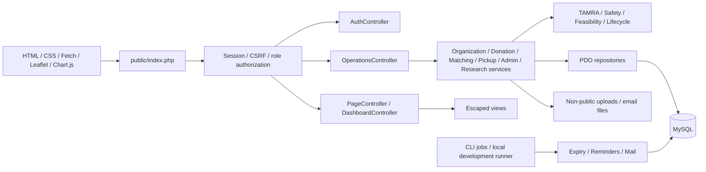
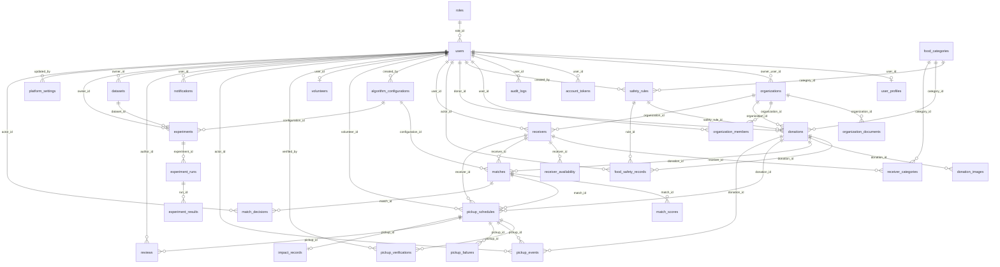

# System architecture

FoodRescue uses Core PHP 8.4+, MySQL/InnoDB, native PDO prepared statements and server-side session authorization. HTML is rendered by escaped PHP views; Vanilla JavaScript uses Fetch for mutations. Business rules live in services, database access in repository classes, HTTP coordination in controllers, and presentation in views. The custom PSR-4 bootstrap also loads Composer libraries for SMTP, QR and PDF output.

## Access boundaries

- Public registration offers donor, receiver and volunteer, immediately active. No admin approval, verification queue or manual activation exists. Donor/receiver organizations are self-service.
- Organization membership grants access to its public operational profile, not other creators' editing privileges. Only an organization creator can edit its details and access supporting documents. Each donor owns their listings; each receiver has their own capacity budget even when members share an organization.
- Normal login is required. Five demo accounts are pre-verified and enabled only in local demo mode. Their email/password form remains the sole entry. Admin and researcher tools sit outside the donation/pickup flow.
- Role and ownership checks protect every operational route; a researcher cannot browse operational listings or retrieve contributors' identities through impact exports. Private documents and own profile images have explicit file permissions at HTTP delivery.
- Email confirmation is optional for operational access. Password resets revoke existing sessions. Session IDs/CSRF rotate on login; idle sessions expire. Unknown recovery emails get the same response.
- Stored timestamps and matching calculations use UTC. Browser forms convert local datetime values to ISO UTC before submission; rendered timestamps convert back to browser-local time.

## Data consistency

Donations use kilograms as the canonical capacity unit, while preserving entered quantity/unit and conversion factor. Monetary/value claims are not inferred. Screening outcomes and original inputs are audited. Mandatory failures cannot be overridden by TAMRA.

TAMRA/feasibility run as independent deterministic services. Configuration rows and rule rows are immutable versions. Match snapshots retain inputs, components and assumptions. Proposals/declines/acceptance decisions are recorded separately. Allocation locks donation then receiver before creating a pickup; capacity-changing pickup transitions and expiry follow the same ordering. InnoDB checks and a generated unique active donation ID provide database enforcement too.

A pickup moves accepted → scheduled → collected → completed; failure, cancellation and expiry release reservations. Collected/completed pickups cannot be expired/reclaimed. One-use pickup tokens are hashed; QR generation exposes the raw token only in the scheduling response. Both donor and receiver confirm completion, and impact records retain collected/distributed amounts separately.

Research datasets and experiments are separate from operational tables. Imported scenario fields are whitelisted; live account details are never copied to research exports. All algorithms receive identical hard constraints and scenario/outcome seeds. Simulated results are labeled; execution time is measured rather than fabricated.

## Full relationship diagram

The `migrations` bookkeeping table tracks forward SQL files. `auth_rate_limits`, `mail_outbox` and `platform_settings` are standalone infrastructure/configuration tables. All other relationships are enforced with foreign keys. The previous organization-review columns were removed in migration 002; they are not part of the current schema.

## Deployment boundaries

Only `public/` is a document root. Private uploads, credentials, Composer code, CLI scripts and exports are outside it. Uploaded content cannot be executed through application routes. Production must use HTTPS/PHP-FPM, external SMTP configuration and scheduled CLI jobs; the local runner starts those jobs alongside PHP’s development server. See deployment.md.
